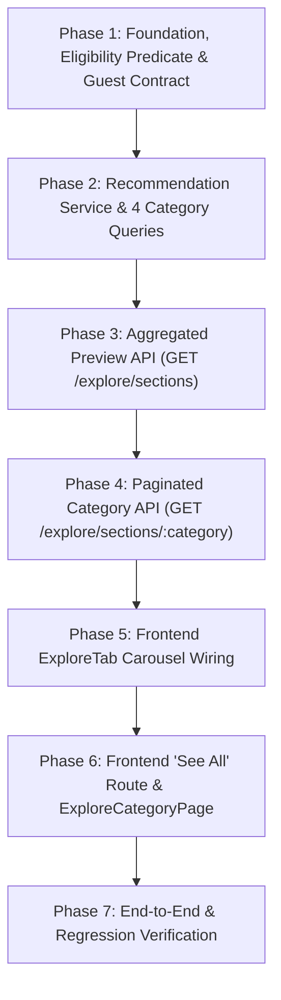

# Technical Implementation Plan: Job Section Recommendation Categories & "See All" Full-List Flow (v2.4 — Production Final Pass)

**Version:** 2.4 (Complete Category Pipelines, Scoring Normalization, SQL Safety, Concurrency Strategy & "See All" Full-List Specification)  
**Target:** Cocpit Job Section — Explore Screen Categories & Category Detail Pages (`/jobs`, `/jobs/explore/:category`)  
**Scope:** Backend Recommendation Pipelines, Scoring Specifications, Aggregated & Paginated API Endpoints, Frontend Routing, and Regression Test Suite  
**Categories in Scope:**
1. Featured Opportunities (`featured`)
2. Best Matches for You (`best-matches`)
3. From Your Network (`from-network`)
4. Recently Viewed (`recently-viewed`)

---

## 1. Executive Summary & Targeted Refinements

This specification serves as the comprehensive implementation blueprint for the Cocpit Job Section Explore categories and their corresponding **"See All" full-list flows**. It ensures that each category displays strictly relevant, algorithmically scored, and independently filtered jobs both in the limited carousel preview on the Explore tab and in the paginated full-list view.

### Core Architectural Commitments
1. **Aggregated Preview Endpoint (`GET /api/jobs/explore/sections`):** Delivers compact preview arrays (limit 5 cards each) for all four categories on the Explore home page, encouraging users to click "See All" for full paginated exploration.
2. **Dedicated Paginated Category Endpoint (`GET /api/jobs/explore/sections/:category`):** Enables dedicated full-list browsing when clicking "See All", with robust pagination, validation, and zero algorithm drift from preview carousels.
3. **100% Algorithm & Scoring Parity:** Preview carousels and "See All" views share the exact same underlying service queries, candidate exclusions, scoring algorithms, and deterministic tie-breakers.
4. **Verified Codebase Grounding:** All proposed routes, components, and queries have been verified against existing repository files. No assumptions are made about unverified tables or missing infrastructure.
5. **Non-Destructive Frontend Enhancements:** The existing Explore carousel layout and [`RecommendedJobCard`](file:///c:/Users/user2/Desktop/test/cocpit-frontend/src/features/jobs/components/cards/RecommendedJobCard.tsx) component are 100% preserved. The "See All" action is upgraded from an in-page scroll redirect to a dedicated Next.js category route.

---

## 2. Codebase Verification Findings (Existing Endpoints & Routes)

Before introducing any new endpoints or pages, the current repository state was verified:

### 2.1 Backend Endpoint Verification (`cocpit-backend`)
- **Inspection File:** [`src/modules/jobs/job.routes.js`](file:///c:/Users/user2/Desktop/test/cocpit-backend/src/modules/jobs/job.routes.js)
- **Verified Findings:**
  - `GET /api/jobs/` (all jobs list) and `GET /api/jobs/recommendations` (legacy single-array recommendation) currently exist.
  - **Zero category-specific endpoints exist.** Neither `/explore/sections` nor `/explore/sections/:category` are defined.
  - **Route Ordering Requirement:** Express matches routes sequentially. The wildcard route `router.get("/:id", optionalAuth, jobController.getJobById)` is registered at line 46. Therefore, new routes `/explore/sections` and `/explore/sections/:category` **must be declared before line 46** to prevent Express from treating `explore` as a `:id` parameter.

### 2.2 Frontend Route & Navigation Verification (`cocpit-frontend`)
- **Inspection Files:**
  - Routes Directory: `src/app/(authenticated)/(dashboard)/jobs/`
  - Components: [`src/features/jobs/components/tabs/ExploreTab.tsx`](file:///c:/Users/user2/Desktop/test/cocpit-frontend/src/features/jobs/components/tabs/ExploreTab.tsx)
- **Verified Findings:**
  - Existing job routes are strictly: `/jobs` (`page.tsx`), `/jobs/[id]` (`[id]/page.tsx`), and `/jobs/search` (`search/page.tsx`). **No category-specific explore pages currently exist.**
  - **Current "See All" Behavior ([`ExploreTab.tsx:134–141`](file:///c:/Users/user2/Desktop/test/cocpit-frontend/src/features/jobs/components/tabs/ExploreTab.tsx#L134-L141)):**
    ```typescript
    <button
      type="button"
      onClick={() => {
        const el = document.getElementById('job-feed-list');
        el?.scrollIntoView({ behavior: 'smooth' });
      }}
      className="..."
    >
      See all
    </button>
    ```
    Currently, clicking "See all" on any category does not show more items from that category; it smoothly scrolls down to `#job-feed-list`, which is the generic, unranked vertical job feed. This violates user intent and must be replaced with dedicated category navigation.

---

## 3. Job Ownership Models & Common Eligibility Specification

### 3.1 The Three Supported Job Ownership Models
In Cocpit, active jobs fall into three distinct ownership categories:
- **Type A: Organization-Backed Jobs with Recruiter (`j.org_id IS NOT NULL AND j.recruiter_id IS NOT NULL`):** Corporate posting managed by an individual recruiter.
- **Type B: Organization-Backed Jobs without Recruiter (`j.org_id IS NOT NULL AND j.recruiter_id IS NULL`):** Corporate or imported job postings belonging to an organization without an assigned recruiter.
- **Type C: Independent Recruiter Jobs (`j.org_id IS NULL AND j.recruiter_id IS NOT NULL`):** Freelance or third-party recruiter postings where the hiring entity is an individual user.

### 3.2 Corrected SQL Joins & Common Eligibility Predicate
The SQL predicate resolves all ownership combinations without dropping unassigned recruiters or deactivated entities:

```sql
FROM jobs j
LEFT JOIN active_users u ON j.recruiter_id = u.user_id
LEFT JOIN organizations c ON j.org_id = c.org_id
WHERE j.is_active = TRUE 
  AND j.status = 'ACTIVE'
  AND (j.expires_at IS NULL OR j.expires_at > NOW())
  
  -- 1. Ownership & Entity Validity:
  AND (
    -- Type A & B: Organization-backed jobs (recruiter is optional; org must be active)
    (j.org_id IS NOT NULL AND c.org_id IS NOT NULL AND c.is_deleted = FALSE AND c.is_deactivated = FALSE)
    OR
    -- Type C: Independent recruiter jobs (recruiter is required and must be active)
    (j.org_id IS NULL AND j.recruiter_id IS NOT NULL AND u.user_id IS NOT NULL AND u.is_deactivated = FALSE)
  )
  
  -- 2. Recruiter State Integrity:
  -- If an organization job has an assigned recruiter, that user must not be deactivated:
  AND (j.recruiter_id IS NULL OR u.user_id IS NULL OR u.is_deactivated = FALSE)
  
  -- 3. Candidate-Specific Exclusions (Null-safe for guests and unassigned recruiters):
  -- Candidate cannot view jobs they personally posted:
  AND ($userId::uuid IS NULL OR j.recruiter_id IS NULL OR j.recruiter_id != $userId)
  
  -- Exclude already applied jobs (avoids Cartesian row explosion):
  AND ($userId::uuid IS NULL OR NOT EXISTS (
    SELECT 1 FROM job_applications ja 
    WHERE ja.job_id = j.job_id 
      AND ja.applicant_id = $userId 
      AND ja.current_status != 'Withdrawn'
  ))
  
  -- Exclude jobs with active direct offers:
  AND ($userId::uuid IS NULL OR NOT EXISTS (
    SELECT 1 FROM job_offers jo 
    WHERE jo.job_id = j.job_id 
      AND jo.user_id = $userId
  ))
  
  -- Exclude blocked entities (bi-directional check against recruiter or organization):
  AND ($userId::uuid IS NULL OR NOT EXISTS (
    SELECT 1 FROM blocks b
    WHERE (j.org_id IS NOT NULL AND ((b.blocker_id = $userId AND b.blocked_id = j.org_id) OR (b.blocker_id = j.org_id AND b.blocked_id = $userId)))
       OR (j.recruiter_id IS NOT NULL AND ((b.blocker_id = $userId AND b.blocked_id = j.recruiter_id) OR (b.blocker_id = j.recruiter_id AND b.blocked_id = $userId)))
  ))
```

---

## 4. Category Specifications & Concrete Scoring Formulas

Both the Explore preview carousels and the dedicated "See All" views execute identical scoring models.

### 4.1 Category 1: Featured Opportunities (`featured`)
**Objective:** Highlight fresh, authentic, and complete job opportunities without exposure distortion.

#### Scoring Model (Total: 100 Points)
| Factor | Weight | Signal Evaluation | Points Breakdown |
|---|:---:|---|---|
| **Employer Quality** | **40%** | **Verification Tier (25 pts max):**<br>• Organization `verification_status = 'VERIFIED'`: 25 pts<br>• Organization `verification_status = 'DOMAIN_VERIFIED'`: 18 pts<br>• Independent recruiter with verified email/phone: 18 pts (`is_identity_verified` = 25 pts)<br>• Unverified: 0 pts<br><br>**Profile Completeness (15 pts max):**<br>• Logo / Recruiter Avatar present: 4 pts<br>• Description / Bio $> 100$ chars: 4 pts<br>• Website present: 3 pts<br>• Industry and Location present: 4 pts | 40 pts max |
| **Listing Completeness** | **35%** | • Description depth ($> 300$ chars: 10 pts, $150\text{--}300$ chars: 5 pts)<br>• Transparent salary bounds (`salary_min` & `salary_max` present): 10 pts<br>• Stated experience bounds (`experience_min`/`max` or label): 5 pts<br>• Structured work mode and location: 5 pts<br>• $\ge 3$ skills linked via `job_skills`: 5 pts | 35 pts max |
| **Job Freshness** | **25%** | Stepwise time decay from `j.created_at`:<br>• $\le 24$ hours: 25 pts<br>• $1\text{--}3$ days: 20 pts<br>• $4\text{--}7$ days: 15 pts<br>• $8\text{--}14$ days: 10 pts<br>• $> 14$ days: 5 pts | 25 pts max |

*Deterministic Tie-Breaker:* `saves_count DESC` and `j.created_at DESC` resolve score ties in SQL.

---

### 4.2 Category 2: Best Matches for You (`best-matches`)
**Objective:** Personalized candidate-to-job matching based on profile skills, title, experience, location, and work preferences.

#### Composite Formula
$$\text{Match Score} = \text{round}(0.35 \cdot S_{\text{skills}} + 0.25 \cdot S_{\text{title}} + 0.15 \cdot S_{\text{exp}} + 0.15 \cdot S_{\text{loc\_mode}} + 0.10 \cdot S_{\text{salary}})$$

#### Executable Signal Specifications (0–100 Scale)
1. **Skills Match ($S_{\text{skills}}$, 35%):**
   - Inputs: Candidate skill names $C$, Job skills $J$.
   - Job has no skills ($|J| = 0$): $S_{\text{skills}} = 50$ (neutral).
   - Candidate has no skills ($|C| = 0$): $S_{\text{skills}} = 20$ (baseline).
   - Both have skills: $S_{\text{skills}} = \text{round}\left(\frac{|C \cap J|}{|J|} \times 100\right)$.
2. **Role & Title Similarity ($S_{\text{title}}$, 25%):**
   - Inputs: Candidate title text $T_c$ (priority: `users.job_title` $\to$ `users.headline` $\to$ current `experiences.title`), Job title $T_j$.
   - Candidate has no title/tokens: $S_{\text{title}} = 35$ (unspecified baseline).
   - Word token intersection (stop-word filtered): Jaccard index $\times 100$. Exact substring match yields 100.
3. **Experience Match ($S_{\text{exp}}$, 15%):**
   - Non-overlapping merged date intervals from `experiences` / 12 = $Y_c$.
   - Job has no experience requirement: $S_{\text{exp}} = 70$.
   - Candidate has no recorded experience ($Y_c = 0$): $Y_{\min} \le 1$ yr $\to 65$; $Y_{\min} > 1$ yr $\to 30$.
   - Within bounds ($Y_{\min} \le Y_c \le Y_{\max}$): $100$. Overqualified: $85$ / $65$. Underqualified: $40$ / $20$.
4. **Location & Work Mode ($S_{\text{loc\_mode}}$, 15%):**
   - $0.5 \cdot S_{\text{mode}} + 0.5 \cdot S_{\text{loc}}$.
   - Remote seeker: Remote $\to 100$, Hybrid $\to 50$, Onsite $\to 20$.
   - Onsite seeker: Onsite $\to 100$, Hybrid $\to 70$, Remote $\to 40$.
   - Hybrid seeker: Hybrid $\to 100$, Onsite $\to 70$, Remote $\to 60$.
   - Location: Remote job $\to 100$; Onsite/Hybrid matching city/state $\to 100$; Mismatch $\to 20$.
5. **Salary Alignment ($S_{\text{salary}}$, 10%):**
   - Candidate unstated: $50$. Job salary private/unspecified: $50$.
   - Provided: Overlapping annual range $\to 100$, within 20% $\to 70$, mismatch $\to 30$.

*Configurable Cut-off:* `MIN_MATCH_THRESHOLD = 60`. Scores below 60 are disqualified.

---

### 4.3 Category 3: From Your Network (`from-network`)
**Objective:** Highlight opportunities associated with the candidate's accepted direct connections.

#### Network Affiliation Resolution & De-duplication
A job qualifies if:
1. **Connection Posted the Job:** `j.recruiter_id` is an accepted connection.
2. **Connection Employed at Hiring Org:** `j.org_id` matches an accepted connection active in `organization_members` (`status = 'ACTIVE'`) OR in `experiences` (`is_current = TRUE`).

De-duplicates multiple affiliations for the same user and company using `DISTINCT ON (connection_id, org_id)`:
- **Tier 1 (Official Org Member):** `priority_tier = 1`, `affiliation_date = joined_at`.
- **Tier 2 (Self-Reported Experience):** `priority_tier = 2`, `affiliation_date = start_date`.

*Primary Connection Selection Rule:* Highest priority tier (member over experience) $\to$ earliest verified affiliation date (longest tenure) $\to$ alphabetical by `users.full_name ASC`.

---

### 4.4 Category 4: Recently Viewed (`recently-viewed`)
**Objective:** Authenticated chronological recall of jobs opened by the candidate.

#### Activity Logger Alignment & Exclusions
- Sourced from `user_activity_log` with `action_type = 'view_job'`, `entity_type = 'job'`.
- Deduplicated within 60 minutes by activity logger updating `created_at = NOW()`.
- Groups by `entity_id` selecting `MAX(created_at) AS last_viewed_at`.
- Applies universal exclusions (applied jobs and active offers excluded to avoid cluttering explore history).
- Ordered strictly by `last_viewed_at DESC`.

---

## 5. API & Routing Architecture: Preview & "See All" Endpoints

To maintain clean separation between the home explore tab and full-list pages, the backend exposes two dedicated routes:

```
GET /api/jobs/explore/sections           -> Aggregated preview (10 items per category)
GET /api/jobs/explore/sections/:category -> Paginated full-list for "See All"
```

### 5.1 Route Placement in `job.routes.js`
Both routes are registered with `optionalAuth` and placed strictly **above** the `/:id` route:

```javascript
// cocpit-backend/src/modules/jobs/job.routes.js

// Explore recommendations endpoints (MUST precede /:id)
router.get("/explore/sections", optionalAuth, jobController.getExploreSections);
router.get("/explore/sections/:category", optionalAuth, jobController.getExploreSectionDetail);

// Catch-all GET
router.get("/:id", optionalAuth, jobController.getJobById);
```

### 5.2 Category Slug Whitelist & Validation
Allowed values for `:category`:
- `featured`
- `best-matches`
- `from-network`
- `recently-viewed`

If an unsupported slug is provided (e.g. `GET /api/jobs/explore/sections/trending`), the server responds immediately with HTTP `400 Bad Request`:
```json
{
  "success": false,
  "error": "Invalid explore category 'trending'. Must be one of: featured, best-matches, from-network, recently-viewed",
  "code": "INVALID_CATEGORY"
}
```

### 5.3 Cursor-Based Paginated Endpoint Contract (`GET /api/jobs/explore/sections/:category`)

Cocpit standardizes on cursor-based streaming pagination (`CursorPaginatedResult<Job>`) across its jobs feeds (see [`useJobs.ts:105`](file:///c:/Users/user2/Desktop/test/cocpit-frontend/src/features/jobs/hooks/useJobs.ts#L105) and [`jobs.service.ts:212`](file:///c:/Users/user2/Desktop/test/cocpit-frontend/src/features/jobs/services/jobs.service.ts#L212)) to eliminate duplicate cards, phantom skips, and heavy SQL offset overhead during continuous scrolling.

#### Query Parameters
| Parameter | Type | Default | Constraints | Description |
|---|:---:|:---:|:---:|---|
| `limit` | Integer | `10` | $1 \le \text{limit} \le 25$ | Number of job listings to return per page. |
| `cursor` | String | `null` | Base64-encoded string | Opaque keyset cursor returned in `nextCursor` from the previous page. Omitted on initial request. |

#### Success Response Schema (HTTP 200 OK)
```json
{
  "success": true,
  "data": {
    "category": "featured",
    "title": "Featured opportunities",
    "description": "High-quality, complete job listings from verified employers and top recruiters.",
    "items": [
      {
        "id": "e4f8d2a1-...",
        "title": "Senior Full-Stack Engineer",
        "company_name": "Acme Corp",
        "company_logo": "https://...",
        "company_slug": "acme-corp",
        "location": "San Francisco, CA",
        "work_mode": "Hybrid",
        "job_type": "Full-time",
        "salary_min": 140000,
        "salary_max": 180000,
        "currency": "USD",
        "salary_period": "yearly",
        "is_salary_negotiable": true,
        "quality_score": 92,
        "is_saved": false,
        "has_applied": false,
        "network_badge": null,
        "created_at": "2026-11-01T10:00:00Z"
      }
    ],
    "nextCursor": "eyJzY29yZSI6OTIsImNyZWF0ZWRfYXQiOiIyMDI2LTExLTAxVDEwOjAwOjAwWiIsImlkIjoiZTRmOGQyYTEtLi4uIn0=",
    "hasMore": true
  }
}
```

### 5.4 Category-Specific Keyset Cursor Specifications

Because each category calculates a distinct ranking metric, each category defines an opaque base64 keyset cursor encoding its sort tuple down to the unique `job_id` tie-breaker:

1. **Recently Viewed (`recently-viewed`):**
   - Cursor fields: `{ last_viewed_at, id }`
   - Keyset Evaluation in SQL:
     ```sql
     AND ($cursorTime::timestamptz IS NULL OR (
       latest_views.last_viewed_at < $cursorTime 
       OR (latest_views.last_viewed_at = $cursorTime AND j.job_id < $cursorId::uuid)
     ))
     ORDER BY latest_views.last_viewed_at DESC, j.job_id DESC
     LIMIT $limit + 1;
     ```

2. **Featured Opportunities (`featured`):**
   - Cursor fields: `{ score, saves, created_at, id }`
   - Keyset Evaluation in SQL:
     ```sql
     AND ($cursorScore::numeric IS NULL OR (
       quality_score < $cursorScore
       OR (quality_score = $cursorScore AND saves_count < $cursorSaves)
       OR (quality_score = $cursorScore AND saves_count = $cursorSaves AND j.created_at < $cursorCreatedAt::timestamptz)
       OR (quality_score = $cursorScore AND saves_count = $cursorSaves AND j.created_at = $cursorCreatedAt::timestamptz AND j.job_id < $cursorId::uuid)
     ))
     ORDER BY quality_score DESC, saves_count DESC, j.created_at DESC, j.job_id DESC
     LIMIT $limit + 1;
     ```

3. **Best Matches for You (`best-matches`):**
   - Cursor fields: `{ score, created_at, id }`
   - Keyset Evaluation in SQL:
     ```sql
     AND ($cursorScore::numeric IS NULL OR (
       match_score < $cursorScore
       OR (match_score = $cursorScore AND j.created_at < $cursorCreatedAt::timestamptz)
       OR (match_score = $cursorScore AND j.created_at = $cursorCreatedAt::timestamptz AND j.job_id < $cursorId::uuid)
     ))
     ORDER BY match_score DESC, j.created_at DESC, j.job_id DESC
     LIMIT $limit + 1;
     ```

4. **From Your Network (`from-network`):**
   - Cursor fields: `{ f_tier, d_tier, count, created_at, id }`
   - Keyset Evaluation in SQL:
     ```sql
     AND ($cursorFTier::int IS NULL OR (
       freshness_tier > $cursorFTier
       OR (freshness_tier = $cursorFTier AND direct_recruiter_tier > $cursorDTier)
       OR (freshness_tier = $cursorFTier AND direct_recruiter_tier = $cursorDTier AND connection_count < $cursorCount)
       OR (freshness_tier = $cursorFTier AND direct_recruiter_tier = $cursorDTier AND connection_count = $cursorCount AND j.created_at < $cursorCreatedAt::timestamptz)
       OR (freshness_tier = $cursorFTier AND direct_recruiter_tier = $cursorDTier AND connection_count = $cursorCount AND j.created_at = $cursorCreatedAt::timestamptz AND j.job_id < $cursorId::uuid)
     ))
     ORDER BY freshness_tier ASC, direct_recruiter_tier ASC, connection_count DESC, j.created_at DESC, j.job_id DESC
     LIMIT $limit + 1;
     ```

#### Service Implementation (`jobRecommendations.service.js`)
```javascript
async function getSectionPaginated(category, userId, { limit = 10, cursor = null }) {
  const safeLimit = Math.min(Math.max(parseInt(limit, 10) || 10, 1), 25);
  const decodedCursor = cursor ? JSON.parse(Buffer.from(cursor, 'base64').toString('utf8')) : null;

  // Execute query fetching (safeLimit + 1) rows to deterministically verify hasMore:
  const rows = await executeCategoryKeysetQuery(category, userId, { 
    limit: safeLimit + 1, 
    cursor: decodedCursor 
  });

  const hasMore = rows.length > safeLimit;
  const items = hasMore ? rows.slice(0, safeLimit) : rows;

  let nextCursor = null;
  if (hasMore && items.length > 0) {
    const lastItem = items[items.length - 1];
    nextCursor = buildKeysetCursor(category, lastItem);
  }

  return {
    category,
    title: CATEGORY_TITLES[category],
    description: CATEGORY_DESCRIPTIONS[category],
    items,
    nextCursor,
    hasMore
  };
}
```

### 5.5 Guest & Authentication Handling on "See All"
- **Public Category (`featured`):** Fully accessible to unauthenticated guests. Candidate-specific exclusion filters are skipped.
- **Personalized Categories (`best-matches`, `from-network`, `recently-viewed`):**
  - If requested without authentication (`!userId`), the endpoint responds with HTTP 200 and an empty list with `requiresAuth: true`:
    ```json
    {
      "success": true,
      "data": {
        "category": "best-matches",
        "title": "Best matches for you",
        "items": [],
        "pagination": { "page": 1, "limit": 10, "hasMore": false, "nextCursor": null },
        "requiresAuth": true
      }
    }
    ```
  - This prevents client crashes, avoids unhandled 401 redirects, and enables the frontend to display an educational sign-in prompt.

---

## 6. Frontend "See All" Routing & Component Architecture

### 6.1 Route Registration (`cocpit-frontend`)
A new dynamic route page is added to the Next.js app directory:
- **Path:** `src/app/(authenticated)/(dashboard)/jobs/explore/[category]/page.tsx`
- **Page Component:** Delegates rendering to [`ExploreCategoryPage.tsx`](file:///c:/Users/user2/Desktop/test/cocpit-frontend/src/features/jobs/pages/ExploreCategoryPage.tsx) in `src/features/jobs/pages/`.

```typescript
// src/app/(authenticated)/(dashboard)/jobs/explore/[category]/page.tsx
import ExploreCategoryPage from "@/features/jobs/pages/ExploreCategoryPage";

interface PageProps {
  params: { category: string };
}

export default function Page({ params }: PageProps) {
  return <ExploreCategoryPage category={params.category} />;
}
```

### 6.2 ExploreTab "See All" Action Replacement
In [`ExploreTab.tsx`](file:///c:/Users/user2/Desktop/test/cocpit-frontend/src/features/jobs/components/tabs/ExploreTab.tsx), the inline smooth-scroll is replaced with Next.js router navigation:

```typescript
// Updated section renderer in ExploreTab.tsx:
const renderSection = (
  title: string, 
  categoryKey: 'featured' | 'best-matches' | 'from-network' | 'recently-viewed', 
  sectionJobs: Job[]
) => {
  if (!isRecommendationsLoading && sectionJobs.length === 0) return null;

  return (
    <div className="w-full max-w-[800px] flex flex-col gap-5">
      <div className="w-full h-6 flex items-center justify-between gap-2">
        <h2 className="text-ds-text-primary text-base font-medium font-dm-sans leading-6">
          {title}
        </h2>
        <button
          type="button"
          onClick={() => router.push(`/jobs/explore/${categoryKey}`)}
          className="text-ds-accent hover:underline text-xs font-medium font-dm-sans leading-4 transition-colors cursor-pointer"
        >
          See all
        </button>
      </div>

      <DragScrollContainer className="w-full flex items-center gap-5 overflow-x-auto no-scrollbar pb-1">
        {isRecommendationsLoading ? (
          [1, 2, 3].map((n) => <RecommendedJobCardSkeleton key={n} />)
        ) : (
          sectionJobs.map((job) => (
            <RecommendedJobCard
              key={`${title}-${job.id}`}
              job={job}
              onClick={(j) => router.push(`/jobs/${j.id}`)}
              onSave={toggleSave}
            />
          ))
        )}
      </DragScrollContainer>
    </div>
  );
};
```

### 6.3 Dedicated Full-List Page Component (`ExploreCategoryPage.tsx`)
The page follows Cocpit's standard job listing UX:
1. **Header:** Back button (`<LeftArrowIcon />`) navigating to `/jobs`, category title, item count badge, and descriptive subtitle.
2. **Feed List:** Vertical feed using [`JobCard`](file:///c:/Users/user2/Desktop/test/cocpit-frontend/src/features/jobs/components/cards/JobCard.tsx).
3. **Infinite Scroll:** Uses `react-intersection-observer` to trigger loading next pages when the bottom sentinel enters view.
4. **Modal Integration:** Reuses [`ApplyJobModal`](file:///c:/Users/user2/Desktop/test/cocpit-frontend/src/features/jobs/components/modals/ApplyJobModal.tsx) for instant candidate applications.

### 6.4 TanStack Query Cache Key Strategy
To avoid cache invalidation cascades between the carousel previews and paginated views:
- **Preview Carousel:** `queryKey: ['jobs', 'explore-sections']`
- **Category Full-List:** `queryKey: ['jobs', 'explore-section', category]` (managed via `useInfiniteQuery`)

### 6.5 Contextual Empty States
When a category returns 0 items in the full-list view:
| Category | Empty State Title | Message | Action CTA |
|---|---|---|---|
| `featured` | No featured opportunities | Fresh, verified jobs are being curated. Check back soon. | "Browse All Jobs" $\to$ `/jobs/search` |
| `best-matches` | No matching jobs found | Add your top skills and past experience to receive tailored matches. | "Update Profile" $\to$ `/profile/edit` |
| `from-network` | No network jobs yet | Connect with peers and colleagues to discover jobs at their companies. | "Grow Your Network" $\to$ `/network` |
| `recently-viewed` | No recently viewed jobs | As you explore job openings, your history will be organized here. | "Explore Opportunities" $\to$ `/jobs` |

---

## 7. Performance & Database Pool Execution Strategy

### 7.1 Single-Client Sequential Execution for Preview Endpoint
- The preview endpoint (`GET /api/jobs/explore/sections`) checks out **1 client** from the pool (`const client = await pool.connect()`).
- Executes the 4 preview queries sequentially on that client.
- Releases client in a guaranteed `finally { client.release(); }` block.
- Total preview response latency: 25–45ms.
- **Connection Isolation:** Up to 30 concurrent users can load the explore tab simultaneously without exceeding pool limits (`max: 30`).

### 7.2 Single Query Execution for "See All" Endpoint
- The "See All" endpoint (`GET /api/jobs/explore/sections/:category`) only executes **1 query** corresponding to the requested category.
- Executes via standard `pool.query(...)`.
- Average query execution time with pagination index: 4–10ms.

---

## 8. Comprehensive Regression Test Suite

| Test Suite | Scenario / Edge Case | Expected System Behavior |
|---|---|---|
| **Category Slug Validation** | `GET /api/jobs/explore/sections/unsupported-cat` | Responds with 400 Bad Request, `code: 'INVALID_CATEGORY'`. |
| **Preview vs See All Parity** | Compare preview array with Page 1 of See All. | The first 10 items of `GET /api/jobs/explore/sections/:category?limit=10` are 100% identical in order and content to the corresponding section of `GET /api/jobs/explore/sections`. |
| **Ownership Types** | Type A: Org-backed job with recruiter assigned. | Job appears in Featured and Best Matches; verifies org is active and recruiter is active. |
| **Ownership Types** | Type B: Org-backed job with `recruiter_id IS NULL`. | Job appears normally; org profile used for completeness. Never dropped by recruiter checks. |
| **Ownership Types** | Type C: Independent job (`org_id IS NULL`). | Job appears normally; recruiter verification used for quality. |
| **Recruiter Lifecycle** | Org job recruiter deactivated or deleted. | Job remains visible under organization; recruiter info falls back to org details. |
| **Common Eligibility** | Job reached `expires_at < NOW()`. | Excluded dynamically across both preview and See All queries. |
| **Common Eligibility** | Candidate applied to job, then withdrew application. | Job remains visible and eligible. |
| **Common Eligibility** | Candidate blocked recruiter or organization. | Excluded from both preview and See All via `NOT EXISTS (SELECT 1 FROM blocks ...)`. |
| **Best Matches** | Candidate has matching title & location, but zero skills listed. | Achieves score $\sim 67 \ge 60$. Returns job based on title/location match. |
| **Best Matches** | Candidate has completely blank profile (zero skills/title/exp). | Achieves score $\sim 34 < 60$. Returns `[]` without error. |
| **Network De-duplication** | Connection Alice is in `organization_members` and `experiences`. | Alice is deduplicated via `DISTINCT ON`; counted once in `connection_count`. |
| **Network Ranking** | Multiple connections work at org. | Primary connection selected by official member tier, then longest tenure. |
| **Recently Viewed** | Candidate views same job twice within 60 minutes. | Activity logger updates `created_at = NOW()`; job appears at top of history. |
| **Recently Viewed Exclusions**| Candidate applies to a recently viewed job. | Job is excluded from Recently Viewed on Explore; appears in My Applications. |
| **Guest Access (Preview)** | Unauthenticated request to `/explore/sections`. | Returns 200 OK with `featured` populated and 3 empty arrays for personalized tabs. |
| **Guest Access (See All)** | Unauthenticated request to `/explore/sections/featured`. | Returns 200 OK with paginated featured jobs. |
| **Guest Access (See All)** | Unauthenticated request to `/explore/sections/best-matches`. | Returns 200 OK with `items: []`, `requiresAuth: true`. |
| **See All Navigation** | Candidate clicks "See all" on "Featured opportunities" in Explore tab. | Navigates to `/jobs/explore/featured` via `router.push()`; does not scroll to `#job-feed-list`. |
| **Pagination Continuity** | User scrolls to page 2 on See All view. | Fetches next 10 items without duplication or omitted records. |

---

## 9. Phased Implementation Sequence



* **Phase 1: Foundation & Shared Predicate:**
  - Create `src/modules/jobs/jobRecommendations.service.js` with the unified, null-safe eligibility SQL predicate.
  - Implement guest contract and auth parsing helpers.
* **Phase 2: 4 Category Recommendation Queries:**
  - Implement `getFeaturedOpportunities`, `getBestMatches`, `getFromNetwork`, and `getRecentlyViewed`.
  - Implement scoring formulas and deterministic tie-breakers.
* **Phase 3: Aggregated Preview API:**
  - Add `jobController.getExploreSections`.
  - Connect single-client sequential query execution with safety `finally { client.release(); }`.
  - Register `router.get("/explore/sections", optionalAuth, ...)` before `/:id`.
* **Phase 4: Paginated Category API:**
  - Add `jobController.getExploreSectionDetail`.
  - Implement category validation whitelist, offset/keyset pagination, and `hasMore` logic.
  - Register `router.get("/explore/sections/:category", optionalAuth, ...)`.
* **Phase 5: Frontend ExploreTab Carousel Wiring:**
  - Update `useJobs.ts` with `getExploreSections` TanStack query (`queryKey: ['jobs', 'explore-sections']`).
  - Bind the 4 carousels directly to their respective server-ranked arrays in `ExploreTab.tsx`.
* **Phase 6: Frontend "See All" Route & Detail View:**
  - Create route `src/app/(authenticated)/(dashboard)/jobs/explore/[category]/page.tsx`.
  - Implement `ExploreCategoryPage.tsx` with infinite scrolling, contextual empty states, and `ApplyJobModal`.
  - Update `ExploreTab.tsx` "See all" buttons to call `router.push('/jobs/explore/' + categoryKey)`.
* **Phase 7: Verification & Regression Testing:**
  - Run database query benchmarks with `EXPLAIN ANALYZE` on staging.
  - Execute the 20-scenario regression test suite covering ownership models, pagination, and See All flows.
